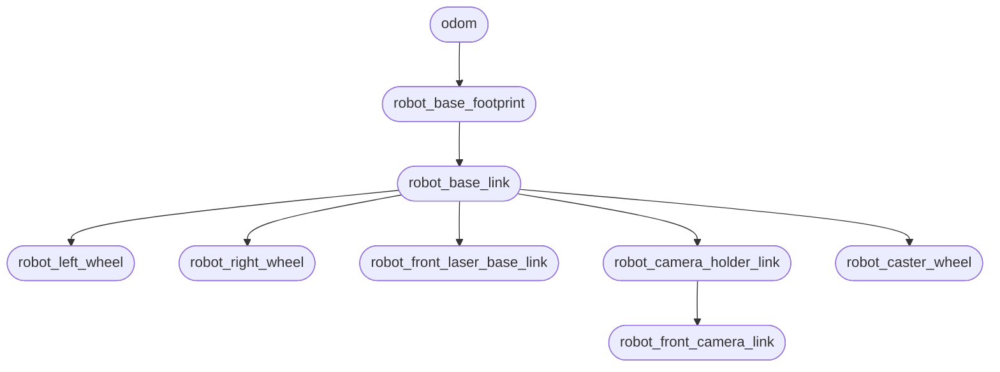

# TortoiseBot

ROS 2 packages for a small indoor mobile robot: simulate it, drive it, map a room, and send
navigation goals. The same stack runs in Gazebo Sim on a laptop or on the robot’s Raspberry Pi.

The colcon workspace, Docker image, Compose, Ansible, and snap live in
[`tortoisebot_fleet`](https://github.com/llabhishekll/tortoisebot_fleet). Fleet clones this
repo into `src/tortoisebot`.


## Structure

```text
.
├── tortoisebot_bringup/          # bringup, Foxglove, optional RViz
├── tortoisebot_description/      # robot description, meshes, sim Gazebo plugins
├── tortoisebot_firmware/         # firmware nodes for motors (differential)
├── tortoisebot_gazebo/           # Gazebo Sim worlds, launch, ROS-Gazebo bridges
├── tortoisebot_intelligence/     # machine learning nodes (standalone)
├── tortoisebot_navigation/       # Nav2 launch, params, and maps
├── tortoisebot_slam/             # Cartographer SLAM and map saver
├── tortoisebot_teleop/           # keyboard, web, twist_mux, waypoint routes
└── third_party/                  # YDLidar + Cartographer (Lyrical patches)
```

Vendor C++ lives in `third_party/`. ROS package names stay upstream (`ydlidar_*`,
`cartographer*`). These trees are patched so they compile and run on Lyrical; remove them once
the original packages work on Lyrical or have been migrated. See
[`third_party/readme.txt`](third_party/readme.txt).

## Docker

Build, Compose, GHCR, native workspace, and deploy are documented in
[`tortoisebot_fleet`](https://github.com/llabhishekll/tortoisebot_fleet). Clone it and run:

```bash
git clone https://github.com/llabhishekll/tortoisebot_fleet.git
cd tortoisebot_fleet
just sim            # Gazebo bringup + Cartographer
just real           # Pi bringup + Cartographer
```

## Robot

TortoiseBot is a two-wheel differential-drive kit with a rear caster. A Raspberry Pi 4 runs the
stack and PWM to an L298N H-bridge (60 RPM BO motors, 65 mm wheels). Sensors are a YDLiDAR S2
on USB (`/dev/ttyUSB0`) and a Raspberry Pi Camera on CSI. Power is an 11.1 V Li-ion pack to the
motors and a 5 V rail for the Pi. There are **no wheel encoders**. On the Pi, Cartographer
publishes the `odom` TF (`use_odometry = false`, `provide_odom_frame = true`). Gazebo Sim
publishes both `/odom` and TF. More model detail:
[models/readme.txt](tortoisebot_description/models/readme.txt).

| Property         | Value                                          |
| ---------------- | ---------------------------------------------- |
| Drive            | differential, no encoders                      |
| Wheel radius     | 0.0325 m                                       |
| Wheel separation | 0.17186 m                                      |
| Max linear       | 0.20 m/s                                       |
| Max angular      | 1.5 rad/s                                      |
| SBC              | Raspberry Pi 4                                 |
| Lidar            | YDLidar S2 (`/dev/ttyUSB0`)                    |
| Camera           | Pi Camera Rev 1.3; 800×600 `/camera/image_raw` |
| Motors           | L298N, RPi.GPIO PWM / dir topics               |

Pi-only Python (`RPi.GPIO`) is **not** in `package.xml` so x86 builds stay clean. Install on
the robot when you need real motors.

### Topics

| Topic                           | Role                               |
| ------------------------------- | ---------------------------------- |
| `/cmd_vel`                      | twist_mux → motors / Gazebo        |
| `/cmd_vel_web`                  | web teleop                         |
| `/cmd_vel_key`                  | keyboard teleop                    |
| `/cmd_vel_nav2`                 | Nav2 velocity smoother             |
| `/odom`                         | odometry topic (Gazebo in sim)     |
| `/scan`                         | lidar                              |
| `/camera/image_raw`             | camera (gz bridge or `camera_ros`) |
| `/lpwm` `/rpwm` `/ldir` `/rdir` | motor debug                        |

### TF tree



Cartographer tracking frame is `robot_base_footprint`. Nav2 `robot_base_frame` is
`robot_base_link`.

## Launch

`bringup` starts the robot (state publisher, sim **or** lidar/firmware/camera, **twist_mux**,
optional Foxglove / web teleop / RViz). SLAM and Nav2 are separate launches.
`use_sim_time:=False` is the Pi. Firmware without GPIO falls back to mock motors.

From fleet, Compose already starts bringup + Cartographer. Use these `ros2 launch` lines in a
native workspace, or `docker compose --profile sim exec bringup_sim bash` (Pi: `bringup_real`)
and run them there. Service names and `just` recipes:
[fleet README](https://github.com/llabhishekll/tortoisebot_fleet).

### Sim and RViz

```bash
ros2 launch tortoisebot_bringup bringup.launch.py use_sim_time:=True
```

Disable RViz and extras (Foxglove / web teleop; twist_mux still runs):

```bash
ros2 launch tortoisebot_bringup bringup.launch.py \
  use_sim_time:=True display_rviz:=False extras:=False
```

On the Pi:

```bash
ros2 launch tortoisebot_bringup bringup.launch.py use_sim_time:=False
```

| Argument       | Default | Meaning                                  |
| -------------- | ------- | ---------------------------------------- |
| `use_sim_time` | `True`  | `True` = Gazebo (with GUI), `False` = Pi |
| `camera_port`  | `0`     | Pi camera                                |
| `display_rviz` | `True`  | Start RViz2 with `robot.config.rviz`     |
| `extras`       | `True`  | Foxglove bridge and web teleop           |

### SLAM

Cartographer after bringup is up. Occupancy grid resolution is **0.05**. Lua:
`tortoisebot_slam/config/{sim,real}/`. `display_rviz` defaults to `True`.

```bash
ros2 launch tortoisebot_slam cartographer_slam.launch.py use_sim_time:=True
```

```bash
ros2 launch tortoisebot_slam cartographer_slam.launch.py use_sim_time:=False
```

This kit has **no wheel encoders**. Gazebo already publishes `/odom`. On the Pi, Nav2 uses
Cartographer’s `odom` TF (`is_odom_only:=True` when driving on a saved map).

| `is_odom_only`    | What Cartographer does                                        |
| ----------------- | ------------------------------------------------------------- |
| `False` (default) | Build a map (occupancy grid + pose). Use while mapping.       |
| `True`            | No new map; lidar `odom` TF for Nav2 on a saved map. Pi only. |

Save the map:

```bash
ros2 launch tortoisebot_slam save_map.launch.py
```

### Navigation

Drive on a saved map after bringup (map server, AMCL, Nav2). `display_rviz` defaults to `True`.
Default map: `tortoisebot_navigation/maps/room_map_sim.yaml`.

```bash
ros2 launch tortoisebot_navigation navigation_server.launch.py use_sim_time:=True
```

On the Pi (`use_sim_time:=False`), navigation also starts Cartographer in **odom-only** mode
(no separate SLAM launch needed):

```bash
ros2 launch tortoisebot_navigation navigation_server.launch.py \
  use_sim_time:=False map_file:=/path/to/map.yaml
```

Configs in `tortoisebot_navigation/config/sim` and `config/real`. Controller and behavior
server publish `cmd_vel_nav`; the velocity smoother outputs `/cmd_vel_nav2`; `twist_mux` (from
bringup) selects teleop or nav onto `/cmd_vel`.

### Teleop

```bash
ros2 run tortoisebot_teleop teleop_twist_keyboard
```

Web / gamepad page (with bringup or `teleop_web.launch.py`):

```text
http://<host>:8000/
```

Open that URL from a browser that can reach the same host on **8000** (page), **9090**
(rosbridge), and **8080** (camera). The page uses `location.hostname` for those sockets, so
`file://` or a hostname the robot does not share will show the UI but not drive.

Keyboard → `/cmd_vel_key`, web → `/cmd_vel_web`. Priorities (web 100 > keyboard 90 > navigation 10) in `tortoisebot_teleop/config/twist_mux.config.yml`.

Waypoint patrol (needs Nav2 `waypoint_follower` running):

```bash
ros2 launch tortoisebot_teleop waypoints.launch.py \
  use_sim_time:=True route:=patrol
```

Foxglove Studio: `ws://localhost:8765`.

### Intelligence

```bash
ros2 launch tortoisebot_intelligence intelligence.launch.py use_sim_time:=True
```

Standalone. Camera `/camera/image_raw` in; `/intelligence/status` and
`/intelligence/detections` out. Model: `share/tortoisebot_intelligence/models/detector.onnx`.

## Known issues

- **No encoders.** Map-based Nav2 on the Pi still depends on Cartographer odom TF. Poor lidar /
  AMCL will drift.
- **YDLidar and camera** fail off-robot (no `/dev/ttyUSB0`, no libcamera). That is expected on
  a laptop.

## Tools

- **ROS 2:** [Lyrical](https://docs.ros.org/) at `/opt/ros/lyrical`.
- **Gazebo Sim 10:** desktop sim (`tortoisebot_gazebo`).
- **RViz 2:** one view per launch in each package `rviz/` folder (`display_rviz`).
- **Foxglove Studio:** `ws://localhost:8765` (bringup `extras`).

## License

Apache-2.0. See [`LICENSE`](LICENSE). Vendor trees keep their upstream licenses.
